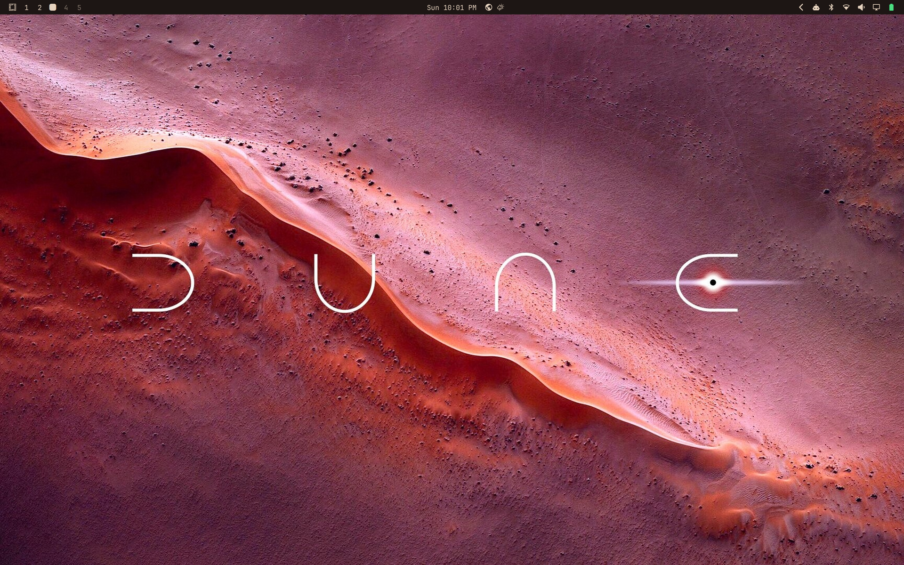
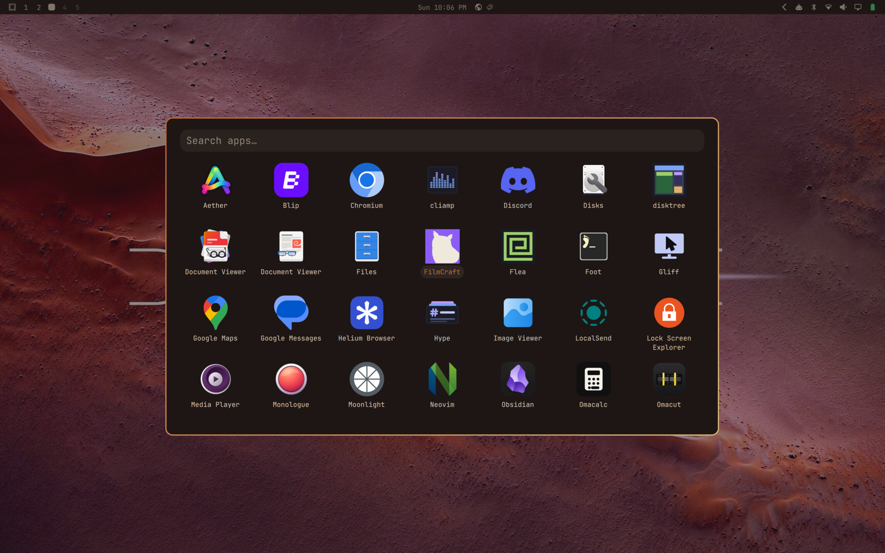
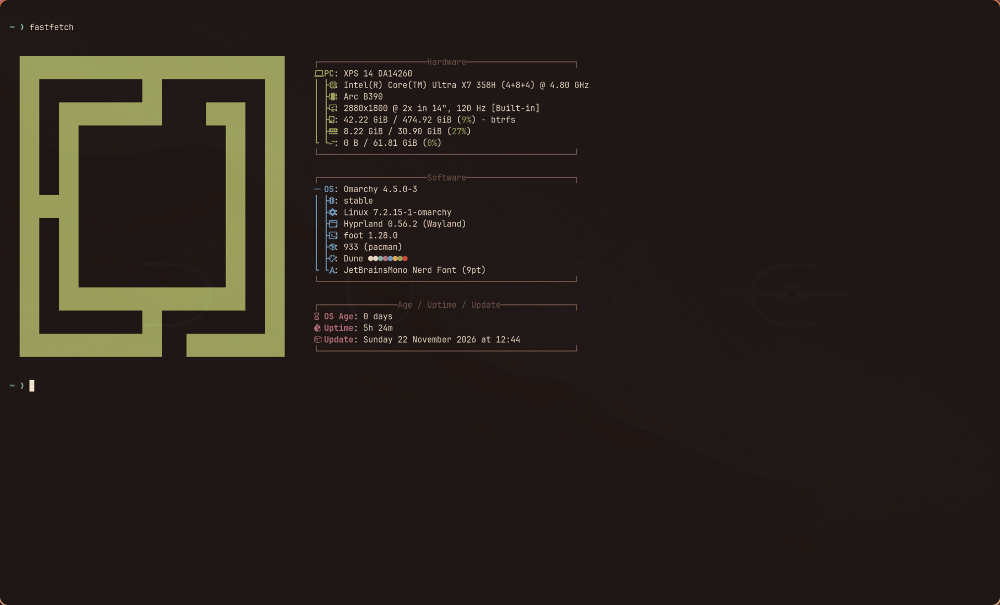
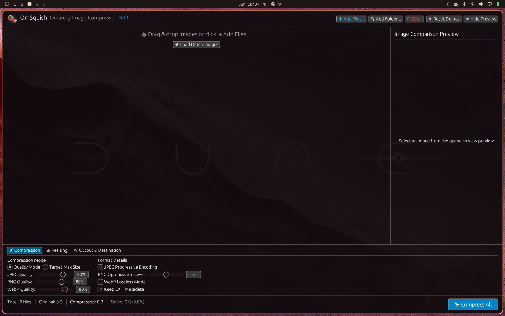

# DUNE — Omarchy Theme



An Arrakis-inspired dark theme for [Omarchy](https://omarchy.org), drawing from the monolithic visual world of Denis Villeneuve's *Dune* film series and modeled closely on the warm, low-glare obsidian-and-sand aesthetic of [Dystopia](https://github.com/jtreguer/omarchy-dystopia-theme).

Deep desert obsidian surfaces, sunlit sand foregrounds, burnt spice-amber accents, and subtle Fremen spice-blue highlights (*Eyes of Ibad*) come together with **27 curated Dune wallpapers** fitted to `2880x1800` (16:10).

---

## Previews

| App Launcher | Terminal (`foot` + `fastfetch`) |
|---|---|
|  |  |

### Application Window & Active Border



---

## Color Palette

GitHub renders color swatches inline beside each hex code below.

### Surfaces & Foregrounds

| Role | Key | Hex |
|------|-----|-----|
| Background | `background` | `#1d1614` |
| Dark Background | `dark_background` | `#171110` |
| Darker Background | `darker_background` | `#110c0b` |
| Lighter Background | `lighter_background` | `#2e2320` |
| Selection | `selection` | `#4a3029` |
| Muted | `muted` | `#6b5148` |
| Dark Foreground | `dark_foreground` | `#8c7464` |
| Light Foreground | `light_foreground` | `#d4bfa9` |
| Foreground | `foreground` | `#e6d3bf` |
| Bright Foreground | `bright_foreground` | `#f5e6d3` |

### Accents & Hyprland Border

| Role | Key | Value |
|------|-----|-------|
| Primary Accent (Spice Amber) | `accent` | `#cf6d3a` |
| Active Window Border | `hyprland_active_border` | `rgba(cf6d3aee) rgba(e8c287ee) 45deg` |

### ANSI Terminal Palette

| Color | Normal | Bright |
|-------|--------|--------|
| Red | `#c9483a` | `#e0624f` |
| Orange | `#d97a3f` | — |
| Yellow (Desert Gold) | `#dba55b` | `#ecc07a` |
| Green (Olive Sage) | `#9aa05c` | `#b3b872` |
| Cyan | `#7ea8a2` | `#9cc2bc` |
| Blue (Fremen Spice Blue) | `#6d97b8` | `#8bb6d6` |
| Magenta | `#b4707a` | `#cc8b93` |
| Brown (Umber) | `#7b4238` | — |

---

## Installation

### One-Command Install (Recommended)

Using the Omarchy CLI:

```bash
omarchy theme install https://github.com/techaeris/omarchy-dune-theme.git
```

Or with the direct command:

```bash
omarchy-theme-install https://github.com/techaeris/omarchy-dune-theme.git
```

### Manual Installation

Clone directly into your Omarchy user themes directory:

```bash
git clone https://github.com/techaeris/omarchy-dune-theme.git ~/.config/omarchy/themes/dune
omarchy theme set DUNE
```

Or clone into a local workspace and symlink it:

```bash
git clone https://github.com/techaeris/omarchy-dune-theme.git ~/Projects/omarchy-dune-theme
ln -s ~/Projects/omarchy-dune-theme ~/.config/omarchy/themes/dune
omarchy theme set DUNE
```

---

## Switching Themes & Cycling Wallpapers

- **Apply the theme:**
  ```bash
  omarchy theme set DUNE
  ```
- **Cycle through all 27 included Dune wallpapers:**
  ```bash
  omarchy theme bg next
  ```
- **Switch back to any other installed theme:**
  ```bash
  omarchy theme list
  omarchy theme set "<theme-name>"
  ```

---

## Supported Apps & Components

This repository follows Omarchy's modern palette-driven theme format (`colors.toml`, `icons.theme`, `backgrounds/`, and `preview.png`). When applied, Omarchy automatically renders all component configs from `colors.toml` via its built-in templates—keeping every app consistent without shipping denied executable/Lua files or introducing unwanted global layout overrides (gaps, rounding, or bar opacity remain untouched):

- **Window Manager:** Hyprland (spice-amber to desert-gold active border gradient)
- **Desktop Shell & UI:** Omarchy Shell (status bar, launcher, menus, OSD, lock screen, notifications)
- **Terminals:** Alacritty, Foot, Ghostty, Kitty
- **Editors & Notes:** Neovim, Helix, VS Code, Obsidian
- **System & Desktop:** GTK / GNOME (`Yaru` icons), btop, Chromium, fcitx5, keyboard RGB
- **CLI & Agent Tools:** gum, Claude Code, Hermes, Pi, t3code

---

## Repository Contents

```text
omarchy-dune-theme/
├── assets/
│   ├── preview.png          # Desktop preview screenshot
│   ├── preview-launcher.png # Omarchy app launcher screenshot
│   ├── preview-terminal.png # Terminal (foot + fastfetch) screenshot
│   └── preview-app.png      # Application window & border gradient screenshot
├── backgrounds/             # 27 Dune wallpapers fitted to 2880x1800 (16:10)
├── colors.toml             # Complete Omarchy color palette & Hyprland border gradient
├── icons.theme             # Icon theme selection (Yaru)
├── preview.png             # Omarchy theme picker preview image
├── LICENSE                 # MIT License (theme configs) & third-party wallpaper notice
└── README.md               # Documentation & attribution
```

---

## Wallpaper Credits & Attribution

While the theme configuration files (`colors.toml`, `icons.theme`, and documentation) in this repository are released under the **MIT License**, the **27 wallpapers in [`backgrounds/`](backgrounds/) are not covered by the MIT License**.

All wallpapers included in this repository were collected from across the internet (including promotional artwork, film stills, and fan art inspired by *Dune*). **Full copyright, ownership, and credit belong strictly to their respective original creators, artists, studios, and rights holders.** No ownership is claimed over any wallpaper artwork.

If you are the creator or rights holder of any image in `backgrounds/` and would like it **credited explicitly** or **removed immediately**, please open a GitHub issue or pull request and it will be addressed promptly.

---

## Acknowledgments

- Color palette structure and low-glare warm dark direction inspired by [omarchy-dystopia-theme](https://github.com/jtreguer/omarchy-dystopia-theme).
- Built for [Omarchy](https://omarchy.org).
